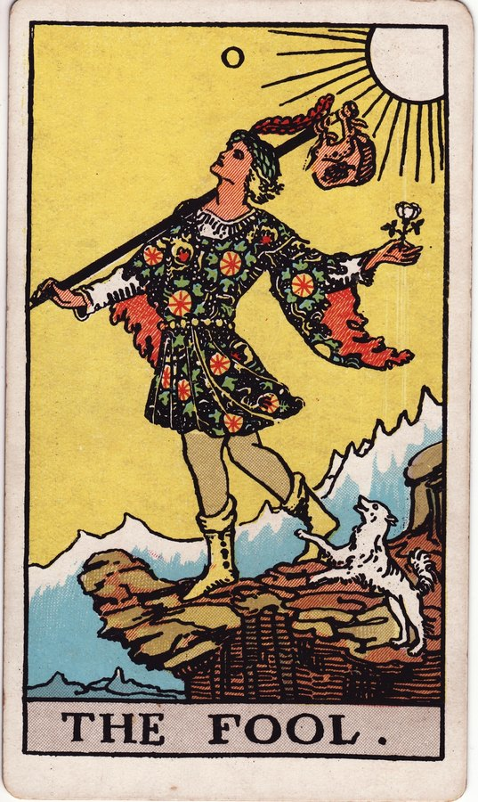

# 🔮 Tarot-it

**在聊天里，给自己抽一张塔罗牌。**

**Draw a tarot card for yourself, right in your chat.**

[简体中文](#简体中文) · [English](#english)

  
  
  

## 简体中文

Tarot-it 是给聊天助手装的塔罗技能。你可以把问题留在心里，自己切牌、选号，也可以让助手替你抽。翻开后会看到绘有原版插画的韦特塔罗牌。想听牌义时，再请助手解读。第一次抽也可以，牌名和正逆位都会随牌面显示。

### 第一次怎么玩

1. **先选牌阵。** 牌阵就是这次抽几张、每张看什么。刚开始可以抽一张，或者用三张看「现状、盲点、下一步」。也有关系、两难选择和年度等牌阵。
2. **再选用哪些牌。** 大阿尔卡纳（22 张）有愚者、星星、太阳等，适合看看这件事的大主题。小阿尔卡纳（56 张）包括四种花色，可以从日常处境里找线索。想两类都用，就选全套韦特（78 张）。
3. **切牌、选号，或请助手抽。** 选好后说「翻开」。想省掉这几步，可以一开始就说「直接抽」。

> 用大阿尔卡纳直接抽一张，只翻牌。

> 我想看最近的工作状态。用全套韦特，抽三张看现状、盲点和下一步。我想自己选号。

### 怎么装

在 GitHub 页面点 **Code → Download ZIP**，解压后找到里面的 `tarot-it` 文件夹。把整个文件夹放到你常用助手的技能目录，具体位置见 [安装说明](tarot-it/references/hosts.md#安装与牌图交付)。支持 Codex、Claude Code、OpenClaw 和 Hermes Agent。装好后，在 Codex 输入 `$tarot-it`，在 Claude Code 输入 `/tarot-it`。

牌面在本地抽取。能在聊天里显示图片时，就直接在聊天里看，也可以在浏览器打开离线牌桌。牌义解读目前以简体中文为主。

## English

Tarot-it adds a tarot table to your chat assistant. You can keep your question to yourself, cut the deck, choose card positions, or ask the assistant to draw for you. When you turn the cards over, you'll see the original Rider–Waite–Smith illustrations. Ask for a reading whenever you feel like it. Each revealed card comes with its name and is marked upright or reversed.

### Your first draw

1. **Choose a spread.** A spread tells you how many cards to draw and what each position is for. Try a single card, or draw three for the situation, the blind spot, and the next step. There are also spreads for relationships, decisions, and the year ahead.
2. **Choose which cards to use.** The Major Arcana (22 cards) includes The Fool, The Star, and The Sun and can help you reflect on bigger themes. The Minor Arcana (56 cards) has four suits and offers prompts for everyday situations. Pick the full deck (78 cards) to use both.
3. **Cut the deck, pick positions, or let the assistant draw.** Say “turn them over” when you're ready. For a quick draw, give your spread and deck choice and ask the assistant to reveal the cards right away.

> Draw one card from the Major Arcana and turn it over right away. Just show me the card.

> I'd like to reflect on work. Use the full deck and draw three cards for the situation, my blind spot, and my next step. I'd like to pick the positions myself.

### Get started

On GitHub, choose **Code → Download ZIP**. Unzip it and move the entire inner `tarot-it` folder to your assistant's skills directory. See [where to put it](tarot-it/references/hosts.md#安装与牌图交付) for Codex, Claude Code, OpenClaw, and Hermes Agent. Once installed, type `$tarot-it` in Codex or `/tarot-it` in Claude Code.

Cards are drawn locally. You can view them in chat where images are supported, or open the offline spread in your browser. Card interpretations are currently written primarily in Simplified Chinese.

## 牌面与署名 · Artwork and credits

Pamela Colman Smith 绘制了这副牌的插画。The card artwork is by Pamela Colman Smith. [牌图与牌义来源 · Artwork and reading sources](tarot-it/references/credits.md)

代码和原创牌义采用 MIT 许可。牌图保留各自的公版标记。Code and original card notes are MIT-licensed. The card artwork retains its public-domain markings. [MIT License](LICENSE)
